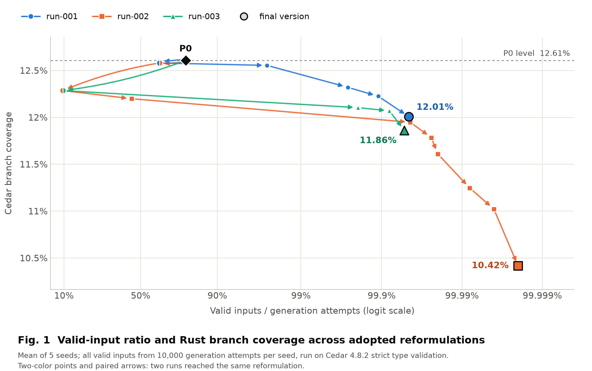

# Cedar predicate reformulation 재측정 결과

실험 ID: `cedar-remeasure-20261122T131403Z`. 상태: **완료** (2026-11-22 13:14–16:48 UTC).
원 실험 `cedar-poc-20261122T025605Z`의 P0와 채택 후보 18개를 고친 측정 도구로 다시 측정했습니다. 모델 호출은 없고 후보 파일은 바뀌지 않았습니다. 모든 후보 파일은 원 실험의 [final-audit.json](../cedar-poc-20261122T025605Z/final-audit.json) 해시와 일치함을 확인한 뒤 측정했습니다.

고정 도구 commit: `7466fa600c1defa9bd12ac5ade71bd2209e01220`. 스크립트 도구 검토(회귀검사 112개 통과, `codex` CLI가 없어 1개 skip)는 `.runs/tool-review-20261122T130800Z/review.json`입니다. 해시와 조건 전체는 [manifest.json](manifest.json), 원시 집계는 [summary.json](summary.json)에 있습니다.

조건은 원 실험과 같습니다: Coq 8.20.0, OCaml 4.14.2, Testing Theorems fork, size=2, seed당 10,000회, 평가 seed 101/202/303/404/505, 미사용 seed 1101/1202/1303/1404/1505. 주 지표도 같습니다: 원본 다섯 전제가 모두 확인된 입력 수 / 전체 외부 생성 시도 수.

## Rust 구현체 coverage 후속 측정과 fig1 갱신

P0와 채택된 18개 버전의 저장 입력을 동일한 평가 seed로 Cedar 4.8.2 Rust 서버에 재생했습니다. 생성 시도 10,000회와 동일한 유효 입력 933개, 두 예산을 비교했습니다. LLVM으로 계측한 strict 타입 검사 경로의 branch coverage이며, `expr` 개수와 다른 지표입니다.

전체 생성 예산에서 Cedar 전체 평균은 P0 12.606%, 최종 후보 run-001/v005 12.009%, run-002/v009 10.416%, run-003/v004 11.861%였습니다. 동일 입력 수로 맞추면 일부 초기 버전은 P0보다 조금 높고, run-001/v002의 분기 합집합에는 P0에서 관측하지 못한 결과 10개가 있습니다. 유효 비율과 coverage의 관계를 일률적인 법칙으로 해석하지 않습니다.

[전체 버전 표·분석·검증 결과](../cedar-rust-coverage-all-20261123/RESULTS.md)



fig1의 가로축은 유효 비율(logit 눈금), 세로축은 Cedar branch coverage입니다. 화살표는 채택 순서, 테두리가 있는 큰 표식은 최종 버전이며, 점은 생성 시도 10,000회/seed의 5개 seed 평균입니다. 기존 expr 기반 그림은 `.runs/cedar-rust-coverage-all-20261123/previous-reports/fig1-before.png`에, 이전 coverage 그림은 같은 디렉터리의 `figure-revisions/`에 보존했습니다.

## 무엇을 고쳤나

원 실험의 수치는 측정 도구의 세 결함에 좌우되었습니다.

1. **엔티티 목록 일반화.** `Original.entity_names`가 상수라서 공식 scheduler가 이를 생성 변수로 취급했습니다(`(entity_names : _, ty) <-G ...`). P0 생성 스키마의 82%가 다른 목록을 써서 `WfSchema`가 거짓이었고, tactic 내부 QuickChick은 약 3,400회 통과 / 20,000 discard에서 포기했습니다. 원본 정리처럼 목록을 리터럴로 쓰면 10,000회 통과 / 약 2,400 discard로 공식 아티팩트 실행(10,000 / 2,386)과 일치합니다.
2. **같은 이름 relation 혼동.** plugin이 relation을 수식 없는 이름으로 구분해서, 직전 버전의 `predicate`를 받는 constructor가 자기 자신의 재귀 호출로 컴파일되었습니다. 직전 predicate의 생성기는 도출되지도 사용되지도 않았습니다. 이제 생성기 도출용 사본에서 후보가 선언한 이름에 `_vNNN`을 붙이고, 사본은 이 치환 외에 원본과 토큰 단위로 같아야 합니다.
3. **검증기 판정 불가.** `Hint Constructors WfExprSyntax`가 상호 귀납 블록의 `WfSetSyntax`, `WfRecSyntax`를 추가하지 않았고 탐색 깊이 12가 속성이 있는 두 엔티티 스키마에 부족했습니다. 필드가 있는 레코드, 원소가 둘 이상인 집합, 대부분의 P0 스키마가 판정 불가였습니다. 힌트를 모두 넣고 깊이를 30으로 올렸습니다. 증명은 여전히 커널이 검사합니다.

도출 직후 두 가드가 실행됩니다. 정리 schedule이 정리 변수가 아닌 것을 생성하거나, 선택된 후보에서 도달하는 relation의 생성기·검사기가 추출 코드에 없으면 batch가 실패합니다. 측정한 115개 batch(대상 23개 × seed 5개) 모두 두 가드를 통과했습니다. 후보 검사는 LLM Inspector 대신 결정적 스크립트(`scripts/cedar/inspection.py`)가 맡습니다(이번 재측정에서는 후보를 새로 채택하지 않으므로 실행하지 않았습니다).

## 평가 seed 결과

P0: 39,225/50,000 = **78.450%**, 판정 불가 1,351회, 확인 무효 0회. 생성기가 결과를 낸 비율은 81.2%로 공식 아티팩트의 discard 제외 비율 80.7%(10,000/12,386)와 비슷합니다.

서로 다른 유효 입력은 입력 전체 해시 기준, 서로 다른 유효 식은 `expr` 필드 기준입니다. 타입 수는 유효 입력의 서로 다른 결과 타입 수, `ite` 비율은 유효 입력 중 최상위 식이 조건식인 비율입니다.

| 대상 | 확인 유효 비율 | seed별 범위 | P0 대비 %p | 직전 대비 %p | 판정 불가 | 결과 없음 | 서로 다른 유효 입력 | 서로 다른 유효 식 | 타입 수 | `ite` 비율 | 원 실험 비율 |
|---|---:|---:|---:|---:|---:|---:|---:|---:|---:|---:|---:|
| P0 | 78.450% | 78.080%–78.720% | — | — | 1,351 | 9,424 | 39,224 | 27,895 | 435 | 61.4% | 0.386% |
| run-001/v001 | 63.194% | 62.530%–63.710% | -15.256 | -15.256 | 1,126 | 17,277 | 31,596 | 22,744 | 396 | 60.9% | 0.302% |
| run-001/v002 | 97.408% | 97.090%–97.630% | +18.958 | +34.214 | 404 | 892 | 48,386 | 9,341 | 261 | 15.5% | 4.918% |
| run-001/v003 | 99.738% | 99.680%–99.790% | +21.288 | +2.330 | 131 | 0 | 19,637 | 4,555 | 175 | 4.9% | 99.518% |
| run-001/v004 | 99.890% | 99.840%–99.940% | +21.440 | +0.152 | 55 | 0 | 38,690 | 2,195 | 108 | 1.9% | 4.890% |
| run-001/v005 | 99.954% | 99.940%–99.970% | +21.504 | +0.064 | 23 | 0 | 45,846 | 1,068 | 68 | 0.8% | 4.890% |
| run-002/v001 | 63.194% | 62.530%–63.710% | -15.256 | -15.256 | 1,126 | 17,277 | 31,596 | 22,744 | 396 | 60.9% | 0.302% |
| run-002/v002 | 9.736% | 9.330%–10.040% | -68.714 | -53.458 | 165 | 44,967 | 4,868 | 3,935 | 199 | 60.9% | 0.070% |
| run-002/v003 | 43.652% | 43.100%–44.770% | -34.798 | +33.916 | 138 | 28,036 | 21,042 | 3,256 | 177 | 11.4% | 4.138% |
| run-002/v004 | 99.956% | 99.950%–99.970% | +21.506 | +56.304 | 22 | 0 | 3,790 | 617 | 77 | 0.9% | 100.000% |
| run-002/v005 | 99.976% | 99.950%–99.990% | +21.526 | +0.020 | 12 | 0 | 3,188 | 436 | 58 | 0.4% | 100.000% |
| run-002/v006 | 99.980% | 99.960%–99.990% | +21.530 | +0.004 | 10 | 0 | 14,882 | 8,762 | 40 | 0.2% | 93.244% |
| run-002/v007 | 99.992% | 99.980%–100.000% | +21.542 | +0.012 | 4 | 0 | 10,197 | 5,527 | 28 | 0.1% | 99.396% |
| run-002/v008 | 99.996% | 99.990%–100.000% | +21.546 | +0.004 | 2 | 0 | 15,129 | 4,673 | 26 | 0.0% | 0.000% |
| run-002/v009 | 99.998% | 99.990%–100.000% | +21.548 | +0.002 | 1 | 0 | 6,985 | 2,473 | 19 | 0.0% | 100.000% |
| run-003/v001 | 9.736% | 9.330%–10.040% | -68.714 | -68.714 | 165 | 44,967 | 4,868 | 3,935 | 199 | 60.9% | 0.070% |
| run-003/v002 | 99.804% | 99.770%–99.860% | +21.354 | +90.068 | 98 | 0 | 2,475 | 2,068 | 130 | 3.0% | 100.000% |
| run-003/v003 | 99.920% | 99.860%–99.950% | +21.470 | +0.116 | 40 | 0 | 1,446 | 1,096 | 101 | 1.6% | 100.000% |
| run-003/v004 | 99.948% | 99.920%–99.990% | +21.498 | +0.028 | 26 | 0 | 10,501 | 6,359 | 88 | 0.8% | 86.102% |

확인 무효는 모든 대상에서 0회입니다.

## 미사용 seed 결과

| 대상 | 평가 seed | 미사용 seed | P0 대비 %p | 판정 불가 | 서로 다른 유효 입력 | 서로 다른 유효 식 | 원 실험 미사용 seed |
|---|---:|---:|---:|---:|---:|---:|---:|
| P0 | 78.450% | 78.604% | — | 1,338 | 39,301 | 27,924 | 0.280% |
| run-001/v005 | 99.954% | 99.952% | +21.348 | 24 | 45,750 | 983 | 4.966% |
| run-002/v009 | 99.998% | 100.000% | +21.396 | 0 | 6,866 | 2,380 | 100.000% |
| run-003/v004 | 99.948% | 99.970% | +21.366 | 15 | 10,316 | 6,259 | 86.136% |

평가 seed와 미사용 seed의 차이는 모든 대상에서 0.16%p 이하입니다.

## 해석과 한계

- P0의 78.45%는 Testing Theorems 생성기의 실제 수준을 반영합니다. 원 실험의 0.386%는 측정 결함 때문이었습니다.
- 후보 대부분은 99.8% 이상입니다. 비율 상승은 주로 항상 성공하는 구체 경우(고정 스키마, 리터럴 등)를 constructor로 추가한 데서 옵니다. 도출된 생성기는 한 경우가 실패하면 다른 경우로 backtrack하므로 discard가 거의 사라집니다. 정량 분석은 [비율 상승과 식 다양성 감소의 원인](#비율-상승과-식-다양성-감소의-원인) 절에 있습니다.
- 식 구성의 편향도 관찰됩니다. 비율이 97% 이상인 후보 13개에서 서로 다른 유효 식은 P0의 27,895개에서 436–9,341개로 줄었고, P0 유효 입력의 61%를 차지하던 조건식(`ite`)은 0–16%로 줄었습니다. run-002·run-003 후보는 요청이 하나인 스키마만 만듭니다(P0는 62%가 요청 둘 이상). 이는 `expr` 기준의 진단 통계이며, 입력 전체의 다양성이나 실제 구현체의 coverage와 같은 지표가 아닙니다. 스키마와 요청 환경이 다르면 같은 식도 다른 Rust 입력이 됩니다.
- 직전 predicate를 받는 constructor가 이제 실제로 샘플링되므로 run-001과 run-003은 채택 순서대로 비율이 단조 증가합니다. run-002/v002(9.736%)와 run-003/v001(같은 측정값)은 요청과 환경을 맞추는 단일 constructor 재정식화 자체가 discard를 늘린 경우로, 측정 결함이 아닙니다.
- v001 후보(63.194%)는 P0보다 낮습니다. 환경 목록을 단일·재귀 경우로 나눈 재정식화가 discard를 늘렸습니다(34.6% 대 18.8%).
- 원 실험의 탐색은 결함 있는 측정값을 피드백으로 받았습니다. 이번 결과는 같은 후보를 다시 잰 것이며, 고친 도구로 새 탐색을 했을 때의 결과가 아닙니다.
- 판정 불가는 무효로 합산하지 않았습니다. 평가 seed의 판정 불가 전제는 `HasType` 4,891회, `WfSchema` 8회입니다. P0의 판정 불가 입력 중 66%는 최상위 식이 조건식이고 나머지는 비교·속성 접근 식입니다.
- 이 측정은 생성기 soundness/completeness나 모든 크기·seed에 대한 우위를 증명하지 않습니다.

## 비율 상승과 식 다양성 감소의 원인

2026-11-23에 추가한 분석입니다. 평가 seed의 저장 입력과 도출된 `theorem.ml`만 사용했습니다. 입력을 다시 생성하거나 후보를 바꾸지 않았습니다.

**요약.** 채택된 후보 중 원래 전제를 더 잘 생성하는 형태는 없었습니다. 원래 전제의 생성 방식을 바꾼 재정식화(run-001/v001, run-002/v002 = run-003/v001)는 비율을 낮췄습니다. 비율 상승은 모두 특수 경우 constructor를 추가한 후보에서 나왔습니다. 이 후보들은 직전 predicate의 부분집합인 경우를 constructor로 추가하고, 직전 predicate는 그대로 받는 constructor로 남겼습니다. 특수 경우의 식은 리터럴, `n = n`, 요청 변수, 닫힌 산술식처럼 거의 고정됩니다. run-002·run-003에서는 스키마도 action id만 다릅니다.

### 도출된 생성기의 선택 방식

후보 predicate의 생성기는 constructor마다 가중치 1을 주는 `backtrack`입니다(예: run-001/v005의 `genSizedSuchThat_predicate_v005_O`). 매번 남은 constructor 중 하나를 균등하게 고르고, 결과가 없으면 그 constructor를 빼고 다시 고릅니다. 선언 순서대로 시도하지 않습니다.

동등성 증명은 입력 집합만 보존하고 샘플링 분포는 보존하지 않습니다. 특수 경우가 직전 predicate의 부분집합이면 합집합이 같다는 증명은 쉽습니다. 그러나 생성기에서는 그 작은 부분집합이 직전 predicate와 같은 확률로 선택됩니다.

### 비율 상승: 실패한 선택을 특수 경우가 대신함

결과 없음은 모든 constructor가 실패할 때만 생깁니다. 항상 성공하는 constructor가 하나 있으면 결과 없음이 0이 됩니다. [run-003/v002](../cedar-poc-20261122T025605Z/run-003/candidates/v002/Candidate.v)는 고정 스키마와 `lit (boolean true)`를 쓰는 constructor 하나만 추가했습니다. 비율은 9.736%에서 99.804%로, 결과 없음은 44,967회에서 0회로 바뀌었습니다. 직전 predicate의 생성 방식은 바뀌지 않았습니다.

### 식 다양성 감소 ①: 원래 경로 비중의 곱셈적 감소

원래 경로 비중은 해당 run에서 추가된 특수 경우 constructor의 어떤 패턴과도 맞지 않는 유효 입력의 비율입니다. 이런 입력은 특수 경우가 없는 첫 재정식화의 경로에서만 나옵니다. 그 재정식화는 run-001의 v001, run-002의 v002, run-003의 v001입니다. 이 경로도 일부 입력은 특수 경우 패턴과 같은 형태로 냅니다. P0 유효 입력은 run-001·run-002·run-003의 패턴에 각각 3.847%, 0.178%, 0.005% 맞습니다. 따라서 표의 값은 원래 경로 비중을 약간 낮게 추정합니다.

| run | v001 | v002 | v003 | v004 | v005 | v006 | v007 | v008 | v009 |
|---|---:|---:|---:|---:|---:|---:|---:|---:|---:|
| run-001 | 100% | 24.912% | 7.899% | 3.103% | 1.271% | | | | |
| run-002 | 100% | 100% | 18.276% | 1.331% | 0.594% | 0.328% | 0.164% | 0.070% | 0.010% |
| run-003 | 100% | 4.942% | 2.570% | 1.225% | | | | | |

- 특수 경우가 항상 성공하면 원래 경로 비중은 두 값의 곱입니다. 하나는 거쳐 가는 각 버전의 constructor 수의 역수를 모두 곱한 값이고, 다른 하나는 원래 경로의 성공률입니다. run-003/v004의 예측은 (1/2)³ × 9.736% = 1.217%, 관측은 1.225%입니다. run-002/v009는 1/768 × 9.736%로 약 6.3개를 예측했고, 49,999개 중 5개를 관측했습니다.
- run-001의 관측값은 단순 곱(1/375 × 63.194% = 0.169%)보다 높습니다. 요청이 하나인 경우만 받는 특수 경우는 요청이 둘 이상인 스키마에서 실패합니다. backtrack은 그 몫을 남은 constructor에 나눕니다.
- `ite` 비율 감소도 같은 값으로 설명됩니다. 원래 경로 비중에 P0의 `ite` 비율 61.4%를 곱한 값과 관측값은 다음과 같습니다. run-001/v002는 15.3%(관측 15.5%), run-001/v005는 0.78%(0.8%), run-002/v004는 0.82%(0.9%), run-003/v004는 0.75%(0.8%)입니다.

### 식 다양성 감소 ②: 특수 경우의 작은 값 공간

size=2에서 최상위 정수 리터럴은 −2..2의 5개, 문자열 리터럴은 9개만 관측되었습니다. 리터럴 특수 경우는 많은 시도를 소수의 식에 씁니다. 여러 패턴에 맞는 입력은 가장 늦게 추가된 constructor로 분류했습니다.

| 대상 | 출처 | 유효 입력 | 서로 다른 식 |
|---|---|---:|---:|
| run-001/v002 | v002 (`true`, `false`) | 36,571 | 2 |
| | 원래 경로 | 12,133 | 9,339 |
| run-001/v005 | v005 (정수·문자열 리터럴) | 33,760 | 14 |
| | v004 (`n = n`, `s = s`) | 11,848 | 14 |
| | 원래 경로 | 635 | 589 |
| run-002/v009 | v009 (`principal`, `resource`, `context`) | 37,495 | 3 |
| | v008 (필드 하나인 레코드) | 6,292 | 1,220 |
| | 원래 경로 | 5 | 5 |
| run-003/v004 | v004 (닫힌 산술식 등) | 27,523 | 5,833 |
| | v003 (리터럴·요청 변수) | 21,839 | 13 |
| | 원래 경로 | 612 | 549 |

run-002/v006과 run-003/v004에서 서로 다른 식이 다시 늘어난 것은 재귀하는 산술식 특수 경우 때문입니다. 이 식들은 요청 변수나 속성을 참조하지 않습니다. 결과 타입 수는 각각 40개, 88개입니다.

### 식 다양성 감소 ③: 스키마와 요청 수

| 대상 | 서로 다른 스키마(`ets`, `acts`) | 요청 둘 이상 |
|---|---:|---:|
| P0 | 38,641 | 62.4% |
| run-001/v005 | 44,396 | 58.1% |
| run-002/v009 | 55 | 0% |
| run-003/v004 | 617 | 0% |

- run-001의 특수 경우는 스키마를 `WfSchema` 생성기로 만듭니다. 식은 고정되어도 스키마는 다양하게 남습니다.
- run-002의 `TinySchema`와 run-003의 고정 스키마는 action id만 다릅니다.
- run-002/v002(= run-003/v001)는 `SchemaToEnvironments`의 결과를 이미 정해진 변수로 적었습니다. 도출된 생성기는 `es`를 타입만 보고 생성한 뒤 `decOpt_SchemaToEnvironments`로 검사합니다. 이 검사를 통과한 입력은 모두 요청이 하나였습니다. 이후 run-002·run-003의 모든 버전에서도 요청이 둘 이상인 유효 입력은 0개입니다.
- Rust coverage도 같은 방향입니다. 최종 후보 중 Cedar 평균과 typecheck 평균이 가장 낮은 것은 run-002/v009(10.416%, 16.18%)입니다.

### 탐색 피드백

Reformulator가 받은 수치는 확인 유효 비율뿐이었습니다. 이 목표에서는 항상 성공하는 특수 경우를 추가하는 것이 가장 쉬운 개선이고, 동등성 증명도 쉽습니다. 원 실험에서는 결함 2 때문에 직전 predicate가 샘플링되지 않았습니다. 그래서 특수 경우만 남은 후보가 100%로 측정되었습니다(run-002/v004 등).

### 해석 범위와 재현

- 유효 비율만으로는 생성기 개선을 판단할 수 없습니다. 새 탐색의 피드백이나 채택 조건에는 원래 경로 비중, 시도당 서로 다른 유효 입력·식 수, coverage 같은 분포 지표가 함께 필요합니다.
- 분류는 특수 경우 constructor의 구문 패턴과 대조한 결과입니다. 샘플마다 실제 생성 경로를 기록한 것은 아닙니다.
- 분석 스크립트와 결과는 `properties/cedar_no_type_error/.runs/cedar-diversity-analysis-20261123/`에 있으며 버전 관리에서 제외됩니다. `classify.py`는 대상별 분류와 통계(`classified.json`)를, `per_origin.py`는 출처별 서로 다른 식 수(`per-origin.json`)를 만듭니다. 두 스크립트는 `scripts/cedar/rust_replay.py`의 파서로 이 실험의 `attempts.jsonl`과 `verdicts.jsonl`을 읽습니다.

```sh
python3 -B properties/cedar_no_type_error/.runs/cedar-diversity-analysis-20261123/classify.py OUT/classified.json
python3 -B properties/cedar_no_type_error/.runs/cedar-diversity-analysis-20261123/per_origin.py OUT/per-origin.json
```

## 재현과 증거

```sh
python3 -B scripts/cedar/inspection.py tool-review --output-dir properties/cedar_no_type_error/.runs/tool-review-NEW
python3 -B scripts/cedar/remeasure.py --source cedar-poc-20261122T025605Z \
  --experiment-id cedar-remeasure-NEW --tool-review properties/cedar_no_type_error/.runs/tool-review-NEW/review.json
```

원시 benchmark·샘플·판정·도출 재작성 기록은 `properties/cedar_no_type_error/.runs/cedar-remeasure-20261122T131403Z/`에 보존되며 버전 관리에서 제외됩니다. P0는 `baseline-property/.runs/benchmark-P0-SEED/`, 후보는 `run-NNN/staged-property/.runs/benchmark-vNNN-SEED/`(각각 `derivation-rewrite.json`, `scheduler.log`, `sources/theorem.ml`, `verdicts.jsonl` 포함)입니다.
