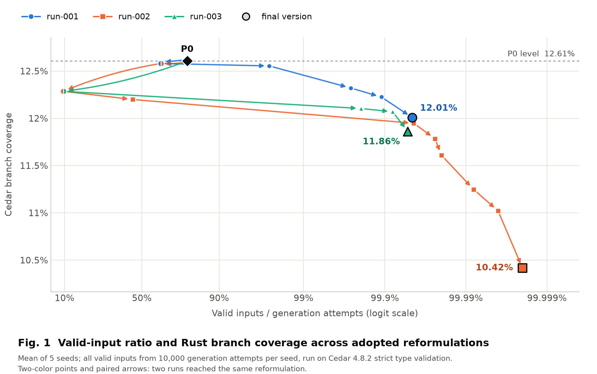

# Cedar Rust branch coverage: 전체 채택 버전

P0와 run-001의 v001–v005, run-002의 v001–v009, run-003의 v001–v004를 비교했습니다. 평가 seed 101/202/303/404/505의 저장 입력을 사용했습니다. 중간 버전에는 저장된 미사용 seed 입력이 없으므로 기존 최종 버전의 미사용 seed 결과와 별도 실험입니다. 입력 재생성과 predicate 변경은 없습니다.

## 결과 해석

기존 run별 비교는 각 run의 **최종 후보**를 비교한 것입니다. 이번에는 채택된 18개 버전을 각각 측정했습니다. 실패하여 채택되지 않은 제안은 이 표에 포함하지 않습니다.

- 생성 시도 10,000회/seed에서 Cedar 전체의 평균 coverage는 P0 12.606%이고, 최종 후보는 run-001/v005 12.009%, run-002/v009 10.416%, run-003/v004 11.861%입니다. 이 표본에서는 각 run의 채택 순서에 따라 Cedar 전체 평균이 낮아졌습니다. 모든 재정식화에 대한 일반 법칙은 아닙니다.
- 같은 933개 유효 입력으로 맞추면 초기 버전의 예외가 보입니다. run-001/v001과 run-002/v001은 12.355%로 P0 12.268%보다 0.087%p 높습니다. run-002/v002와 run-003/v001도 12.286%로 0.017%p 높습니다. 작은 차이이며 통계적 우위로 주장하지 않습니다. run-002의 v005→v006, v008→v009에서도 소폭 회복합니다. 최종 후보 3개는 두 예산의 세 측정 범위 모두에서 P0보다 낮습니다.
- **평균과 합집합은 다릅니다.** run-001/v002의 전체 생성 예산 Cedar 평균은 12.554%로 P0보다 낮지만, 5개 seed의 합집합은 303개로 P0의 295개보다 큽니다. P0에서 관측하지 못한 분기 결과 10개를 실행했고 P0 분기 2개를 놓쳤습니다. 새 결과는 속성 접근의 안전성 검사와 레코드·속성 타입의 최소 상한 계산에 위치합니다. 이는 고정 표본의 차이이며 P0가 그 분기에 도달할 수 없다는 뜻은 아닙니다.
- **측정 범위에 따라서도 다릅니다.** run-001/v002의 validator 평균은 전체 생성 예산에서 22.388%로 P0 22.239%보다 높습니다. Cedar 전체 평균만으로 validator 내부의 변화를 모두 설명할 수 없습니다.
- 입력 전체 중복, 식 구성, 구현체 coverage는 서로 다른 관찰입니다. 유효 비율 상승만으로 실행 분기의 폭이 개선됐다고 할 수 없고, 중간 버전의 새 분기와 작은 회복을 무시해 “모든 reformulation이 다양성을 줄였다”고 결론 내릴 수도 없습니다.

## Fig. 1



가로축은 확인 유효 비율(logit 눈금), 세로축은 Cedar 전체 branch coverage입니다. 화살표 하나가 채택된 재정식화 하나이고, 테두리가 있는 큰 표식이 각 run의 최종 버전입니다. 점은 생성 시도 10,000회/seed에서 얻은 유효 입력 전부를 실행한 5개 seed 평균입니다. 세로축은 0에서 시작하지 않습니다. run-001과 run-002의 v001, run-002 v002와 run-003 v001은 각각 서식이나 이름만 다른 같은 재정식화여서 생성 입력이 같습니다. 이 둘은 두 색의 점과 나란한 화살표로 표시했습니다.

동일 유효 입력 933개 예산과 합집합 결과는 아래 표에, seed별 값은 [summary.json](summary.json)에 있습니다. 이전 그림은 원시 기록의 `figure-revisions/`에 보존했습니다.

PDF·SVG·수치 CSV·그림 provenance는 원시 기록의 `report/figures/`에 있습니다.

## 측정 조건

- 대상은 Cedar 4.8.2 원본 Rust 서버의 strict 정적 타입 검사입니다. 식뿐 아니라 스키마와 요청 범위도 전달합니다. 정책 평가기 coverage는 아닙니다.
- rustc nightly-2026-11-21 (c7d5ba59d8e11ee2e2204b173458eec4cb41c973), LLVM 23.1.6. `-C instrument-coverage -Z coverage-options=branch -C debuginfo=2`; `llvm-profdata merge` 및 `llvm-cov export`를 사용했습니다.
- 같은 계측 바이너리, 생성 파서를 포함한 Cedar 소스 분모를 사용했습니다. generic 인스턴스의 동일 소스 분기 결과는 합칩니다. 서버와 일반 의존성은 제외합니다.
- 각 대상·seed의 10,000회 생성 시도에서 확인 유효 입력을 순서와 중복을 유지하여 모두 재생합니다. None과 판정 불가는 생성 예산에 포함하지만 Rust에는 보내지 않습니다.
- 동일 입력 예산은 모든 대상·seed에서 처음 933개 유효 입력입니다. 전체 95개 군의 최소 유효 입력 수로 맞췄습니다. 생성률이 낮은 중간 버전 때문에 기존 최종 버전 비교의 7,829개보다 작습니다. 두 실험의 수치를 직접 연결하면 안 됩니다.
- 표의 coverage는 seed별 비율의 산술평균입니다. 합집합은 별도 표에 있습니다. 버전끼리는 독립 표본이 아니며 유의성이나 단조 관계를 주장하지 않습니다.

## 전체 생성 예산: 10,000회/seed

| 대상 | 확인 유효 비율 | Rust 호출(5 seeds) | Cedar 평균 | validator 평균 | typecheck 평균 |
|---|---:|---:|---:|---:|---:|
| P0 | 78.450% | 39,225 | 291.2/2310 (12.61%) | 149.0/670 (22.24%) | 38.2/136 (28.09%) |
| run-001-v001 | 63.194% | 31,597 | 290.6/2310 (12.58%) | 148.8/670 (22.21%) | 37.8/136 (27.79%) |
| run-001-v002 | 97.408% | 48,704 | 290.0/2310 (12.55%) | 150.0/670 (22.39%) | 37.8/136 (27.79%) |
| run-001-v003 | 99.738% | 49,869 | 284.6/2310 (12.32%) | 145.8/670 (21.76%) | 36.2/136 (26.62%) |
| run-001-v004 | 99.890% | 49,945 | 282.4/2310 (12.23%) | 144.0/670 (21.49%) | 35.2/136 (25.88%) |
| run-001-v005 | 99.954% | 49,977 | 277.4/2310 (12.01%) | 139.6/670 (20.84%) | 31.8/136 (23.38%) |
| run-002-v001 | 63.194% | 31,597 | 290.6/2310 (12.58%) | 148.8/670 (22.21%) | 37.8/136 (27.79%) |
| run-002-v002 | 9.736% | 4,868 | 283.8/2310 (12.29%) | 145.4/670 (21.70%) | 34.4/136 (25.29%) |
| run-002-v003 | 43.652% | 21,826 | 281.8/2310 (12.20%) | 143.6/670 (21.43%) | 34.0/136 (25.00%) |
| run-002-v004 | 99.956% | 49,978 | 276.0/2310 (11.95%) | 138.4/670 (20.66%) | 30.6/136 (22.50%) |
| run-002-v005 | 99.976% | 49,988 | 272.2/2310 (11.78%) | 135.4/670 (20.21%) | 28.0/136 (20.59%) |
| run-002-v006 | 99.980% | 49,990 | 268.2/2310 (11.61%) | 134.2/670 (20.03%) | 28.0/136 (20.59%) |
| run-002-v007 | 99.992% | 49,996 | 259.8/2310 (11.25%) | 131.2/670 (19.58%) | 26.6/136 (19.56%) |
| run-002-v008 | 99.996% | 49,998 | 254.6/2310 (11.02%) | 130.2/670 (19.43%) | 25.2/136 (18.53%) |
| run-002-v009 | 99.998% | 49,999 | 240.6/2310 (10.42%) | 127.0/670 (18.96%) | 22.0/136 (16.18%) |
| run-003-v001 | 9.736% | 4,868 | 283.8/2310 (12.29%) | 145.4/670 (21.70%) | 34.4/136 (25.29%) |
| run-003-v002 | 99.804% | 49,902 | 279.6/2310 (12.10%) | 141.4/670 (21.10%) | 33.4/136 (24.56%) |
| run-003-v003 | 99.920% | 49,960 | 278.8/2310 (12.07%) | 140.4/670 (20.96%) | 32.2/136 (23.68%) |
| run-003-v004 | 99.948% | 49,974 | 274.0/2310 (11.86%) | 136.8/670 (20.42%) | 30.0/136 (22.06%) |

## 동일 유효 입력 예산: 933개/seed

| 대상 | Rust 호출(5 seeds) | Cedar 평균 | validator 평균 | typecheck 평균 |
|---|---:|---:|---:|---:|
| P0 | 4,665 | 283.4/2310 (12.27%) | 145.2/670 (21.67%) | 36.0/136 (26.47%) |
| run-001-v001 | 4,665 | 285.4/2310 (12.35%) | 146.8/670 (21.91%) | 36.8/136 (27.06%) |
| run-001-v002 | 4,665 | 282.2/2310 (12.22%) | 144.2/670 (21.52%) | 33.8/136 (24.85%) |
| run-001-v003 | 4,665 | 274.2/2310 (11.87%) | 136.4/670 (20.36%) | 31.4/136 (23.09%) |
| run-001-v004 | 4,665 | 268.2/2310 (11.61%) | 134.4/670 (20.06%) | 28.8/136 (21.18%) |
| run-001-v005 | 4,665 | 257.4/2310 (11.14%) | 129.8/670 (19.37%) | 25.6/136 (18.82%) |
| run-002-v001 | 4,665 | 285.4/2310 (12.35%) | 146.8/670 (21.91%) | 36.8/136 (27.06%) |
| run-002-v002 | 4,665 | 283.8/2310 (12.29%) | 145.4/670 (21.70%) | 34.4/136 (25.29%) |
| run-002-v003 | 4,665 | 276.0/2310 (11.95%) | 138.0/670 (20.60%) | 30.8/136 (22.65%) |
| run-002-v004 | 4,665 | 253.2/2310 (10.96%) | 129.2/670 (19.28%) | 24.6/136 (18.09%) |
| run-002-v005 | 4,665 | 243.4/2310 (10.54%) | 126.0/670 (18.81%) | 21.6/136 (15.88%) |
| run-002-v006 | 4,665 | 245.6/2310 (10.63%) | 126.6/670 (18.90%) | 22.4/136 (16.47%) |
| run-002-v007 | 4,665 | 233.2/2310 (10.10%) | 125.8/670 (18.78%) | 22.4/136 (16.47%) |
| run-002-v008 | 4,665 | 229.2/2310 (9.92%) | 125.2/670 (18.69%) | 21.2/136 (15.59%) |
| run-002-v009 | 4,665 | 230.8/2310 (9.99%) | 121.6/670 (18.15%) | 21.4/136 (15.74%) |
| run-003-v001 | 4,665 | 283.8/2310 (12.29%) | 145.4/670 (21.70%) | 34.4/136 (25.29%) |
| run-003-v002 | 4,665 | 266.8/2310 (11.55%) | 132.4/670 (19.76%) | 27.4/136 (20.15%) |
| run-003-v003 | 4,665 | 262.2/2310 (11.35%) | 131.6/670 (19.64%) | 25.2/136 (18.53%) |
| run-003-v004 | 4,665 | 260.8/2310 (11.29%) | 131.8/670 (19.67%) | 26.8/136 (19.71%) |

## Cedar 분기 결과 합집합

새 분기와 누락 분기는 같은 예산의 P0 합집합을 기준으로 셉니다. 합집합은 seed별 평균과 다릅니다.

| 대상 | 전체 예산 합집합 | 새 분기 / 누락 | 동일 입력 합집합 | 새 분기 / 누락 |
|---|---:|---:|---:|---:|
| P0 | 295 | 0 / 0 | 288 | 0 / 0 |
| run-001-v001 | 294 | 0 / 1 | 289 | 2 / 1 |
| run-001-v002 | 303 | 10 / 2 | 294 | 8 / 2 |
| run-001-v003 | 289 | 0 / 6 | 279 | 1 / 10 |
| run-001-v004 | 288 | 0 / 7 | 279 | 0 / 9 |
| run-001-v005 | 285 | 0 / 10 | 269 | 0 / 19 |
| run-002-v001 | 294 | 0 / 1 | 289 | 2 / 1 |
| run-002-v002 | 295 | 8 / 8 | 295 | 9 / 2 |
| run-002-v003 | 287 | 0 / 8 | 283 | 0 / 5 |
| run-002-v004 | 283 | 0 / 12 | 269 | 1 / 20 |
| run-002-v005 | 279 | 0 / 16 | 269 | 0 / 19 |
| run-002-v006 | 278 | 0 / 17 | 260 | 0 / 28 |
| run-002-v007 | 272 | 0 / 23 | 253 | 0 / 35 |
| run-002-v008 | 270 | 0 / 25 | 242 | 0 / 46 |
| run-002-v009 | 255 | 0 / 40 | 253 | 0 / 35 |
| run-003-v001 | 295 | 8 / 8 | 295 | 9 / 2 |
| run-003-v002 | 284 | 0 / 11 | 277 | 1 / 12 |
| run-003-v003 | 285 | 0 / 10 | 280 | 0 / 8 |
| run-003-v004 | 279 | 0 / 16 | 271 | 0 / 17 |

## 검증과 해석 범위

- Rust 호출 총 870,896회, 응답별 개수: `{"true": 870896}`. 두 예산의 입력은 겹칩니다.
- 대표 실제 입력 965개를 upstream Coq serializer와 구체적 등식으로 대조하고 커널 검사했습니다. 전체 직렬화 동등성 정리는 아닙니다.
- 무입력 대조군에서 Cedar 분기 실행은 0입니다. 모든 군의 분모 동일성과 종료 시 바이너리 해시를 검사합니다.
- 이 컴파일러의 branch 계측은 `if`/`if let`을 기록하지만 `match`의 각 arm을 별도로 기록하지 않습니다. 전체 제어 흐름이나 MC/DC가 아닙니다.
- coverage는 이 API와 표본에서 실행한 계측 분기의 폭입니다. 입력 공간 전체의 다양성과 동일한 개념이 아닙니다. 절대 비율의 분모에는 해당 API에서 도달하지 않는 코드도 있습니다.
- 기존 탐색의 피드백은 유효 비율이었습니다. 이 결과는 채택 버전의 사후 평가이며 coverage 최적화 탐색이 아닙니다.

## 재현

```sh
python3 -B scripts/cedar/rust_replay.py --mode all-versions \
  --source properties/cedar_no_type_error/.runs/cedar-remeasure-20261122T131403Z \
  --output properties/cedar_no_type_error/.runs/cedar-rust-coverage-all-NEW --workers 8
python3 -B scripts/cedar/report_rust_coverage.py \
  --evidence properties/cedar_no_type_error/.runs/cedar-rust-coverage-all-NEW \
  --output properties/cedar_no_type_error/experiments/cedar-rust-coverage-all-NEW
python3 -B scripts/cedar/plot_rust_coverage.py \
  --summary properties/cedar_no_type_error/experiments/cedar-rust-coverage-all-NEW/summary.json \
  --output properties/cedar_no_type_error/experiments/cedar-rust-coverage-all-NEW/figures
```

그림 생성에는 Matplotlib이 필요합니다.
## 실행 및 검증 증거

- 원시 기록: `properties/cedar_no_type_error/.runs/cedar-rust-coverage-all-20261123/`.
- 95개 대상·seed × 두 예산 = 190개 독립 프로파일. 전체 생성 예산 782,261회, 동일 입력 예산 88,635회로 총 870,896회 Rust 호출이며 모두 `true`입니다.
- 전체 호출의 순서·ID·attempt·입력 해시·payload 해시와 원본 소스 해시를 대조했습니다: [replay-audit.json](../../.runs/cedar-rust-coverage-all-20261123/replay-audit.json).
- 대표 입력 965개 Coq 직렬화 등식·커널 검사 통과. 전체 회귀 검사 123개 통과: [regression-verification.json](../../.runs/cedar-rust-coverage-all-20261123/regression-verification.json).
- 기존 바이너리와 동일한 SHA-256: `9c8daeeabbc05537cc635725558a4e6198cc7506db5b2ad62f980111907debba`. 환경 변경이나 재빌드는 없었습니다.
- 이전 보고서와 expr 기반 fig1은 원시 기록의 `previous-reports/`에 보존했습니다. 기존 최종 후보의 미사용 seed 결과 보고서는 `properties/cedar_no_type_error/.runs/cedar-rust-coverage-20261123/report/`에 있습니다.
- 버전별 전체 입력·Rust payload의 중복 통계는 원시 기록의 `report/payload-statistics.json`에 있습니다. 이 표본의 19개 대상 모두에서 서로 다른 전체 입력 수와 서로 다른 payload 수가 같았습니다. coverage 측정에서는 중복을 제거하지 않았습니다.
- 회귀·응답 감사와 그림 검증의 최종 기록은 원시 기록의 `report/verification.json`에 있습니다.
